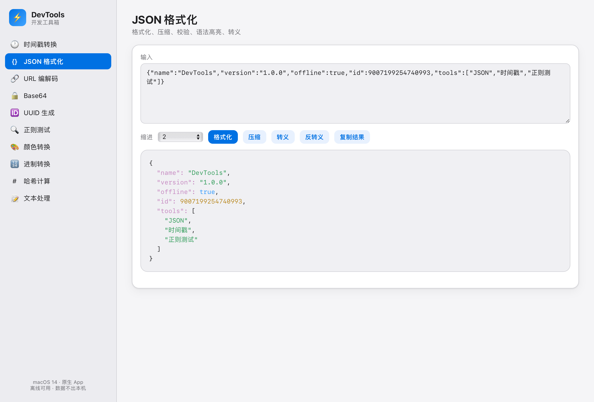

# DevTools 开发工具箱

一个离线可用的 macOS 开发工具箱。Swift 原生窗口承载本地 HTML、CSS 和 JavaScript，无第三方运行时依赖。

[](https://github.com/xikee/DevTools/actions/workflows/ci.yml)
[](https://github.com/xikee/DevTools/releases/latest)
[](LICENSE)


[下载最新版](https://github.com/xikee/DevTools/releases/latest) · [反馈问题](https://github.com/xikee/DevTools/issues/new/choose) · [参与贡献](CONTRIBUTING.md)



## 功能

| 工具 | 支持内容 |
| --- | --- |
| 时间戳转换 | 秒／毫秒与日期互转、本地时区／UTC、手动选择单位、严格校验日期与小数秒 |
| JSON 格式化 | 格式化、压缩、校验、语法高亮、转义／反转义；保留原始数字精度和重复键 |
| URL 编解码 | 组件／整体编解码、Query 参数解析、重复参数与片段区分 |
| Base64 | UTF-8 文本、标准和 URL-safe 编码与解码 |
| UUID | 随机 v4 UUID，单次生成 1～500 个 |
| 正则测试 | 捕获组、替换、独立 Worker 执行、超时终止与取消 |
| 颜色转换 | HEX → RGB／HSL、RGB → HEX、系统取色器与实时预览 |
| 进制转换 | 二／八／十／十六进制互转、任意精度整数、负数和常见前缀 |
| 哈希计算 | MD5、SHA-1、SHA-256，按 UTF-8 文本计算 |
| 文本处理 | 大小写、空白整理、移除空行、行去重／排序、LF／CRLF 与文本统计 |

应用支持系统深浅色外观，以及 ⌘C、⌘V、⌘X、⌘A、⌘Z 等标准编辑快捷键。输入内容在本机处理，应用没有后端服务、遥测或自动更新请求。

## 下载与安装

系统要求：**macOS 14 Sonoma 或更高版本**。

1. 打开 [Releases](https://github.com/xikee/DevTools/releases/latest)。
2. 下载 `DevTools-v版本号-macos-universal.zip`，同一个安装包支持 Apple Silicon 和 Intel Mac。
3. 解压后，将 `DevTools.app` 拖入“应用程序”目录并启动。

安装包采用 ad-hoc 本地签名，**尚未使用 Apple Developer ID 签名及公证**。首次启动时，macOS 可能要求在“系统设置 → 隐私与安全”中确认打开。请先核对下载来源与校验值，不需要关闭系统的全局安全保护。

### 校验下载文件

将安装包与同一 Release 的 `SHA256SUMS.txt` 放在同一目录，执行：

```bash
shasum -a 256 -c "SHA256SUMS.txt"
```

出现 `OK` 表示下载内容与该版本公布的校验值一致。

## 本地开发

### 环境要求

- macOS 14 或更高版本。
- Xcode Command Line Tools，提供 Swift、AppKit 和 WebKit SDK。
- Node.js 24 或更高版本，仅用于运行回归测试；应用运行不需要 Node.js。

如果未安装 Apple 命令行工具，可执行 `xcode-select --install` 后按系统提示安装。

```bash
git clone https://github.com/xikee/DevTools.git
cd "DevTools"
bash "build.sh" --open
```

默认按当前电脑架构构建，输出为 `dist/DevTools.app`。构建过程不会替换 `/Applications` 中的应用，也不会覆盖已有输出；再次构建时请指定新的输出目录。

```bash
# 通用应用，同时支持 Apple Silicon 和 Intel
bash "build.sh" --arch universal --output "dist/universal"

# 仅构建 Intel 版本
bash "build.sh" --arch x86_64 --output "dist/intel"
```

也可以直接使用浏览器打开 `index.html` 体验工具；桌面版以系统 WKWebView 的行为为准。

### 测试

```bash
# 逻辑、边界输入、真实独立线程、超时与取消
TZ=Asia/Shanghai node --test "tests/regression.test.cjs"
TZ=America/New_York node --test "tests/regression.test.cjs"

# 真实 WKWebView：离线 Worker、页面交互及应用逻辑
xcrun swift "tests/webkit-smoke.swift"
```

CI 在 Apple Silicon 与 Intel macOS 环境执行回归、类型检查、构建和 WKWebView 检查。

## 发布版本

项目版本号来自 [`VERSION`](VERSION)，同时写入应用的 `Info.plist`。

本地打包：

```bash
bash "scripts/package-release.sh" universal "dist/release"
```

输出通用 ZIP、`SHA256SUMS.txt` 以及构建完成的 `.app`。打包前会检查应用签名并执行 WKWebView 测试。

维护者发布新版本时，更新 `VERSION` 和 [`CHANGELOG.md`](CHANGELOG.md)，通过 CI 后推送对应的 `vX.Y.Z` 标签。Release 工作流会校验标签与版本号、构建通用应用、测试并上传安装包及校验文件。具体步骤见 [贡献指南](CONTRIBUTING.md#发布流程)。

## 项目结构

```text
main.swift                  原生窗口与本地资源加载
MainMenu.swift              macOS 主菜单和编辑快捷键
index.html                  页面结构与样式
app.js                      工具逻辑与正则 Worker
build.sh                    macOS 应用构建
VERSION                     单一版本号来源
scripts/package-release.sh  安装包与 SHA-256 校验文件
tests/                      逻辑回归与真实 WKWebView 测试
icon/                       图标资源与生成脚本
.github/                    CI、Release 工作流与协作模板
```

## 使用边界

- 自动时间戳单位按数值大小推测，早期日期或特殊范围请手动选择秒／毫秒。未指定时区的标准日期按系统本地时区解析。
- JSON 格式化保留数值原文；不会替你合并重复键或改变数字类型。
- 正则任务最多执行 1 秒；测试文本最多 100 万字符；匹配列表最多 1000 条或 10 万字符，单项长文本会截断。
- Base64 面向 UTF-8 文本，不是二进制文件转换器。字符统计采用 JavaScript 字符串长度，部分 emoji 会计为多个代码单元。
- MD5 和 SHA-1 用于兼容性校验，不适合密码存储或安全签名。
- 当前没有文件持久化、跨设备同步或自动更新功能。

## 贡献与许可

欢迎提交可复现的问题和聚焦的改进。请阅读 [CONTRIBUTING.md](CONTRIBUTING.md)；安全问题请参阅 [SECURITY.md](SECURITY.md)。

本项目采用 [MIT License](LICENSE)。
